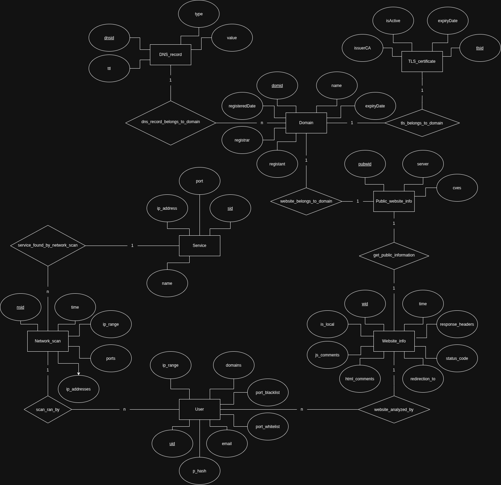

# Host & Traffic Testing Professional - HTTPro
> Nyílt forráskódú hálózatfelderítő és HTTP forgalomelemző platform

## Projekt célja

### Alap cél
A projekt célja egy szoftver létrehozása, amely képes felderíteni és elemezni egy belső hálózatot és annak eszközeit. Képes megtalálni az elemzett hálózatokon a webszervereket és azok ellen is felderítést indítani. Nem csak a lokális hálózaton futtatott webalkalmazásokon képes elemzést indítani, hanem a világhálóra publikált webapplikációkon és az azokhoz tartozó domaineken is képes felderítést végrehajtani.

### Milyen problémát oldd meg?
Kibervédelmi mérnököknek, etikus hackereknek, tanulóknak és minden rendszerbiztonsággal foglalkozó szakembereknek készült, aki engedéllyel hajtana végre elemzést és felderítést belső hálózatokon és webapplikációkon. Leegyszerűsíti, automatizálja a szakemberek munkáját azzal, hogy az információkat egy helyre gyűjti a rendszer, könnyen tudja azt kezelni egy reszponzív webes felületről, vagy konzolalkalmazásból és vissza tudja nézni a korábbi elemzések eredményeit, összehasonítani őket.

## Rendszer

### Rendszer struktúra
A szoftvercsomag a modularitásra épül. A projekt több, egymástól elkülönő komponensből épül fel.

- Publikusan hostolt weboldal : Nyílvános bemutató oldal, dokumentáció és telepítési útmutató.
- Web GUI : Lokálisan futó, reszponzív grafikus kezelőfelület
- CLI : Python-alapú parancssoros kezelőfelület
- Backend : Közös REST API, üzleti logika, feladatkezelés
- Scanner : Python script, amely a a vizsgálatokat, felderítéseket, elemzéseket hajtja végre
- Database : Közös tároláshoz

A GUI és CLI ugyan azt a scannert, backendet és adatbázist használja, így azonos funkciókhoz, fiókokhoz és adatokhoz férnek hozzá.

Minden szolgáltatás külön konténerben fog futni és saját végponton keresztül érhető el, így nem szükséges a helyi gépen futtatni. 

Ha külön szerveren van futtatva program, akkor a webes felületről érhető csak el a mi eszközünkről a scanner, vagy ssh-n keresztül a szerveren futtatva a CLI-ből.

A publikus oldal nem a scanner infrastruktúra része.
`
Platformfüggetlenség van tervben (Windows, Linux, macOS) alapú plat`formokon is működjön.

Minden személy, aki a repot klónozza, az saját lokálisan telepített példányt kap, amelyhez kizárólag az fér hozzá, aki az eszközhöz is hozzáfér. Így a program bármelyik komponensét szabadon lehet módosítani.

Bash parancsként is lehet futtatni, de ez csak ugyan azt a cli-bol indithato python kodot futtatja, amely meghivja a scannert.

A rendszer Docker Compose segítségével telepíthető.

## Funkciók

## Felhasználókezelés
- Regisztrálás email, jelszó alapján.
- Több felhasználó létrehozása
- Minden felhasználónak saját története van
- A felderítések és analízisek eredményei felhasználóhoz kötve tárolva
- Jelszavak hashelve, salt-al tárolva az adatbázisban
- Elfelejtett jelszó email küldés
- 2FA bejelentkezés
- Regisztrálásnál emailben történő megerősítés

### Hálózat felfedezés
- Hosztok és nyitott portok felderítése
- Szolgáltatások és webszerverek felismerése
- Felderírése eredmények tárolása felhasználókhoz kötve
- Felderítési eredmények vizualizációja (webes felületen)
- IP range megadás lehetőség
- IP whitelist megadás lehetőség
- IP blacklist megadás lehetőség
- Port whitelist megadás lehetőség,
- Port blacklist megadás lehetőség
- Port alapértelmezett listákból választása (kis csomag (leggyakrabban hasznalt portok), normal csomag (nagyon gyakran hasznalt portok), nagy csomag (gyakran hasznalt portok), web csomag (webhez hasznalt portok), minden port (minden port lehetoseg), stb...)

## Webes analizáló
- HTTP válasz fejlécek ellenőrzése
- TLS tanúsítványok ellenőrzése
- Státuszkód ellenőrzése
- Átirányítás ellenőrzése
- HTML kommentek ellenőrzése
- JavaScript kommentek ellenőrzése

## Webes analizáló publikus weboldalra
- Minden webes analizáló funkció
- Szerver ellenőrzése
- Szever verzió alapján CVE keresése
- DNS rekordok lekérdezése
- Domain tulajdonos adatainak lekérdezése

## Futtatás és menedzsment
- Vizsgálatok indítása Web GUI-ból, vagy CLI-ből
- Korábbi eredmények megtekintése
- Vizsgálati eredmények exportálása

## Technológiai stack

### Frontend
| Komponens | Technológia |
| :----- | -----: |
| Build eszköz | Vite |
| Programozási nyelv | TypeScript |
| Keretrendszer | React |
| Dizájn | Costum CSS |
| Egységtesztelés | Vitest |
| Csomagkezelő | npm |

### Backend
| Komponens | Technológia |
| :----- | -----: |
| Programozási nyelv | TypeScript |
| Keretrendszer | NestJS |
| Egységtesztelés | Jest |
| Csomagkezelő | npm |

### Scanner és vizsgáló
| Komponens | Technológia |
| :----- | -----: |
| Programozási nyelv | Python |
| Csomagkezelő | uv |
| Egységtesztelés | Pytest |
| Csomagok |  |
| Hálózati scan | Nmap |

### Verziókezelés
| Komponens | Technológia |
| :----- | -----: |
| Programozási nyelv | Git |
| Csomagkezelő | GitHub |

### Adatbázis
| Komponens | Technológia |
| :----- | -----: |
|  | PostgreSQL |

### Konténerizáció

| Komponens | Technológia |
| :----- | -----: |
|  | Docker |
|  | Docker Compose |

