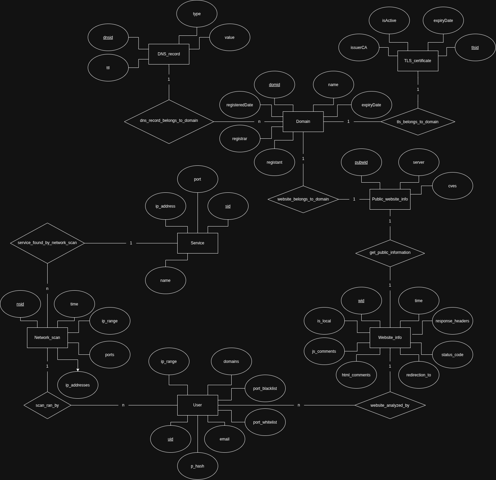

# ... & Traffic Testing Professional - HTTPro
`Nyílt forráskódú HTTP forgalom és domain elemző platfrom`

## Projekt célja

`A projekt célja egy szoftver létrehozása, amely lokális és világhálóra publikált weboldalakat és az ahhoz tartozó nyílvános információkat gyűjti össze és elemzi.`

### Kinek készült és milyen problémát oldd meg?
Etikus hackereknek, pentestereknek, red teamereknek, OSINT felderítőknek, weboldal tulajdonosoknak, webüzemeltetőknek, tanulóknak és  bármilyen kibervédelemmel foglalkozó szakembereknek készült, aki engedéllyel hajtana végre elemzést és webapplikációkon. Leegyszerűsíti, automatizálja a szakemberek munkáját azzal, hogy az információkat egy helyre gyűjti a rendszer, könnyen tudja azt kezelni egy reszponzív webes felületről, vagy konzolalkalmazásból. vissza tudja nézni a korábbi elemzések eredményeit és összehasonítani őket.

## Rendszer

### Rendszer struktúra
A szoftvercsomag a modularitásra épül. A projekt több, egymástól elkülönő komponensből épül fel.

- **Web GUI** : Publikusan deployolt, reszponzív grafikus kezelőfelület
- **CLI** : Python-alapú parancssoros kezelőfelület
- **Backend** : Közös REST API, üzleti logika, feladatkezelés, végpontok kezelése
- **Scanner** : Python script, amely a a vizsgálatokat, felderítéseket, elemzéseket hajtja végre
- **Database** : Felhasználói adatok, beállítások, korábbi elelmzések közös tárolásához

Az felderítő szoftver futtatásának neve "*hunt*".

A GUI és CLI ugyan azt a scannert, backendet és adatbázist használja, így azonos funkciókhoz, fiókokhoz és adatokhoz férnek hozzá.

Platformfüggetlenség van tervben a konzolos alkalmazáshoz (Windows, Linux, macOS alapú platformokon is működjön).
A Pythonos CLI-t bashbol es powershellbol is lehet majd futtatni huntot.

A rendszer Docker Compose segítségével lesz felépítve, ahol minden egyes komponens külön konténerbe kerül.

## Biztonság

### Domain validáció

`A felhasználó csak olyan domainekre küldhet kérést, amely engedélyezett a számára.`

A felhasználónak minden publikusan hosztolt weboldalra csak abban az esetben van lehetősége huntot indítani, ha előtte validálta, hogy tulajdonában áll az ahhoz tartozó domain.

A rendszer generál egy tokent, ezt a tokent egy txt DNS rekordként kell elmentenie. 

A felhasználónak még a validálás előtt elkell mentetnie a domaint a saját domaineket tartalmazó listájába.
Ebben a listában egy domain 3 státuszban létezhet:
- *Validált* : A token levan generálva validálva van
- *Validálásra vár* : A token levan generálva és validálva van
- *Nem validált* : A token nincs legenerálva és nincs validálva

A tokenekhez, a mentett domainekhez és annak beállításához szabályok a követketők:
1. A tokenek a generálástól számított 6 hónapon belül lejárnak.
1. Ha egy token lejárt, akkor a domain státusza "*Nem validált*" állapotba kerül és a token törlődik az adatbázisból.
1. A tokeneket újra lehet generálni.
1. Ha a tokent már a domain validált állapotában generálják újra, akkor a domain státusza "*validálásra vár*" állapotba kerül
1. Minden hunt és átirányítás előtt a rendszer ellenőrzi, hogy a domain "*Validált*" státuszban van-e és jelenleg is tartalmazza-e valemelyik txt DNS rekord a token értékét.
1. Ha a tokent a rendszer nem találja a hunt előtt a rekordok között, akkor a hunt el sem indul, továbbá a domain státusza átvált "*Validálásra vár*"-t állapotra.

### Átirányítás

A hunt futtatása előtt a felhasználónak van lehetősége az adott huntra vonatkozó beállításokat állítani, ennek része az "*Átirányítás engedélyezése*" is. Ennek a beállításnak 3 lehetősége van, ezek:
- *Minden átirányítás engedélyezése* : Nem kérdez rá, csak megpróbálja végrehajtani az átirányítást.
- *Összes átirányítás tiltása* : Az összes átirányítást elutasítja.
- *Feltételes átirányítás* : Minden átirányítás előtt rákérdez az átirányításra.

`Kizárólag validált domainekre lehet átirányítást engedélyezni.`

Az adatok kapcsolatai a követkető képpen lesz megvalósítva.

## Funkciók

### Felhasználókezelés
- Regisztrálás email, jelszó alapján.
- Jelszavak hashelve, salt-al tárolva az adatbázisban
- Elfelejtett jelszó email küldés
- 2FA bejelentkezés
- Regisztrálásnál emailben történő megerősítés

### Webes analizáló
- HTTP válasz fejlécek ellenőrzése
- TLS tanúsítványok ellenőrzése
- Státuszkód ellenőrzése
- Átirányítás ellenőrzése
- HTML kommentek ellenőrzése
- JavaScript kommentek ellenőrzése
- Aloldal és fájl felderítés

### Webes analizáló publikus weboldalra
- Minden webes analizáló funkció
- Szerver ellenőrzése
- Szever verzió alapján CVE keresése
- DNS rekordok lekérdezése
- Domain tulajdonos adatainak lekérdezése

### Futtatás és menedzsment
- Vizsgálatok indítása Web GUI-ból, vagy CLI-ből
- Korábbi eredmények megtekintése
- Vizsgálati eredmények exportálása

## Technológiai stack

### Frontend
| Komponens | Technológia |
| :----- | -----: |
| Build eszköz | Vite |
| Programozási nyelv | TypeScript |
| Keretrendszer | React |
| Dizájn | Costum CSS |
| Egységtesztelés | Vitest |
| Csomagkezelő | npm |

### Backend
| Komponens | Technológia |
| :----- | -----: |
| Programozási nyelv | TypeScript |
| Keretrendszer | NestJS |
| Egységtesztelés | Jest |
| Csomagkezelő | npm |

### Scanner és vizsgáló
| Komponens | Technológia |
| :----- | -----: |
| Programozási nyelv | Python |
| Csomagkezelő | uv |
| Egységtesztelés | Pytest |
| Csomagok |  |
| Hálózati scan | Nmap |

### Verziókezelés
| Komponens | Technológia |
| :----- | -----: |
| Programozási nyelv | Git |
| Csomagkezelő | GitHub |

### Adatbázis
| Komponens | Technológia |
| :----- | -----: |
|  | PostgreSQL |

### Konténerizáció

| Komponens | Technológia |
| :----- | -----: |
|  | Docker |
|  | Docker Compose |